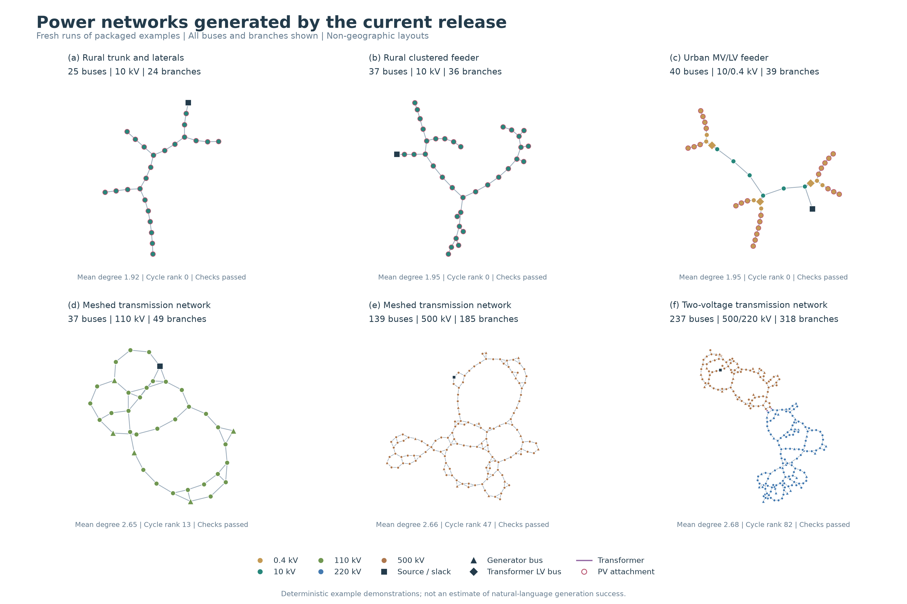
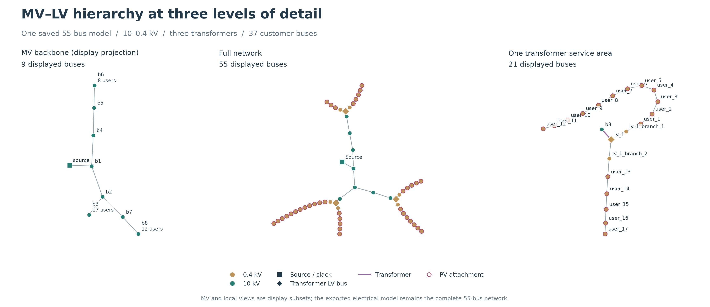
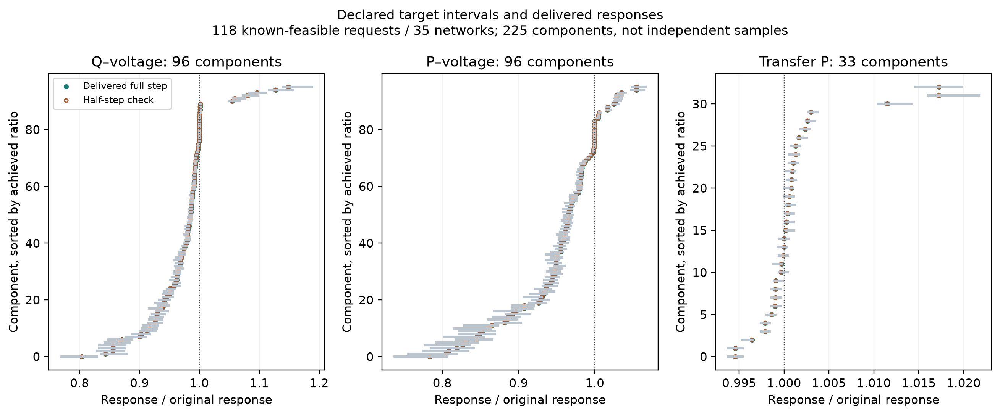

# GridGen-Agents

**Generate and revise research power-grid models from natural-language requirements.**

A LangChain/LangGraph agent connects research intent to physical generators, engineering rules, equipment catalogs and AC solvers. The system delivers verified models, callable OpenDSS or MATPOWER exports, and network visualizations. Optional response design constructs cases with specified static electrical behavior.

[Method](docs/paper/METHOD.md) | [Results](docs/results/README.md) | [Architecture](docs/architecture.md) | [Usage](docs/usage.md) | [Verification](docs/verification.md)

**Current release: M102.** Package version: `0.1.0`. Original code: [Apache-2.0](LICENSE). Reference material retains its [third-party terms](THIRD_PARTY.md).

## Workflow

1. Compile the complete request into source-bound requirements and modification permissions.
2. Select a scenario, topology and equipment, then invoke the appropriate physical generator.
3. Check structure, requirements and electrical feasibility; diagnose failures and make permitted revisions.
4. Verify saved models and exports before delivery. Optional research tasks also require their specified response and finite experiment to pass.

The objective is a correct final model satisfying the request. Recoverable internal errors do not invalidate an independently accepted delivery. Missing models, unmet requirements and unresolved electrical violations remain unsuccessful deliveries.

## Supported cases

| Family | Features | Export |
|---|---|---|
| Urban/rural distribution | Diverse radial backbones, laterals, villages, normally-open ties, overhead/cable equipment, load/PV attachments | OpenDSS; MATPOWER through the supported balanced adapter |
| Three-phase distribution | Phase-resolved loads/PV, partial-phase branches, unbalance checks | OpenDSS |
| MV-transformer-LV-customer | Explicit transformers, LV branches and single-phase customers | OpenDSS |
| Transmission | Meshing, generators, voltage layers, transformers, joint line parameters and P/Q-limit checks | MATPOWER |

Exact requested bus counts are preserved; omitted counts use disclosed defaults. Urban/rural labels inform design but do not prescribe exclusively overhead or underground networks. Reference cases and sourced catalogs provide priors for plausible synthetic cases, rather than exact replicas of utility assets.

## Verified results

| Evidence | Final accepted result | Scope |
|---|---:|---|
| Natural-language generation and revision | **30/30** deliveries | 15 positive requests, two execution identities each |
| Targeted planning and large-network checks | **8/8** executions | Four requests, including 223-bus transmission and protected revisions |
| Electrical-response generation | **118/118** certified tasks | 35 networks; 225 response components |
| Independent response recomputation | **48/48** target ratios | 12 original/generated network pairs |
| Exported-model reuse | **144/144** AC evaluations and wrapper reloads | Static load perturbations, with/without external Q control |

These are measured cases, not a guarantee for arbitrary inputs. [Results and CSV/JSON tables](docs/results/README.md) define the acceptance rules, denominators and provenance. Static electrical usability and external controller convergence are distinct measurements.

M102 completes recognized planning clauses without redundant full replanning, places unspecified transmission generators by graph separation, and retains isolated OpenDSS worker execution. The verified 223-bus case has maximum generator reactive output **15.07 MVAr**, unchanged **28.8 MVAr** limits and automatic repairs disabled.

## Installation

Use Python 3.11 or later on Linux. Some process locks require `fcntl`; Windows users can use WSL.

```bash
python -m venv .venv
source .venv/bin/activate
python -m pip install -e '.[dev,transmission,plots]'
feeder-agents --help
```

Structured generation requires no API key:

```bash
feeder-agents generate --spec examples/distribution_villages.yaml --id villages_demo
feeder-agents hierarchy --spec examples/hierarchical_urban.yaml --id urban_demo
feeder-agents transmission --spec examples/transmission_237.yaml --id transmission_demo
```

For language generation, configure your provider:

```bash
cp .env.example .env
# Set the API key, service URL and model name in .env.
feeder-agents design 'Generate a rural 10 kV feeder with exactly 37 buses, three villages and 480 kW total demand. Use research defaults for unspecified settings.' --id language_demo
python -m streamlit run app.py
```

Open `http://localhost:8501`. Recent recorded language experiments used `qwen3.7-plus`; the model is configurable. `.env` and runtime workspaces are excluded from Git. Use a new run ID when changing a request. Public presentation is English; bilingual parsing fixtures preserve exact decoded inputs through Unicode escapes.

## Research intent and electrical response

Three explicit research-task contracts are implemented:

- **`voltage_control`:** Q-to-voltage response and finite external reactive support.
- **`static_pv_impact`:** P-to-voltage response and existing-PV off/on comparison.
- **`transmission_transfer`:** AC transfer response and a balanced finite MW transfer at fixed Q.

```bash
feeder-agents research-design --plan examples/research_voltage_control.yaml --id voltage
feeder-agents research-design --plan examples/research_static_pv_impact.yaml --id pv
feeder-agents research-design --plan examples/research_transmission_transfer.yaml --id transfer
feeder-agents response-design --plan examples/response_selective_25.yaml --id selective
```

Multiple ports can be targeted, for example increasing A's sensitivity while retaining B's response interval. The numerical loop combines electrical path information, conditional compensation, candidate deduplication and actual AC verification. Bounds remain relative to the original model. Device, geometry and reconnection changes require declared permission; an unsuccessful search grants no additional authority.

The agent supports generation, feedback revisions, explicit permission amendments, artifact retrieval and verified handoff. Arbitrary language-to-response-matrix compilation is not claimed. Researchers connect their own downstream controllers or optimizers. Annual time series, dynamic stability, protection coordination and general OPF/N-1 certification are outside the delivered scope.

## Current-release figures





All buses and branches remain in the electrical exports. Display layouts are non-geographic. The [gallery manifest](docs/assets/gallery_manifest.json) records runtime, model and figure hashes. Regenerate with `python scripts/build_gallery.py`.



[Representative callable models](docs/results/models/README.md) and [compact results](docs/results/README.md) are included. Large candidate directories and raw provider conversations stay outside the publication tree.

## Verification

```bash
python scripts/release_smoke.py --transmission
python scripts/check_examples.py
python scripts/verify_release_results.py
python -m pytest -q
```

[Local verification](docs/verification.md) and [GitHub Actions](https://github.com/ZachariahZhou/GridGen-Agents/actions/workflows/package-check.yml) are recorded separately. See [snapshot scope](docs/snapshot-scope.md) and [file hashes](SNAPSHOT.json) for the curated contents.
