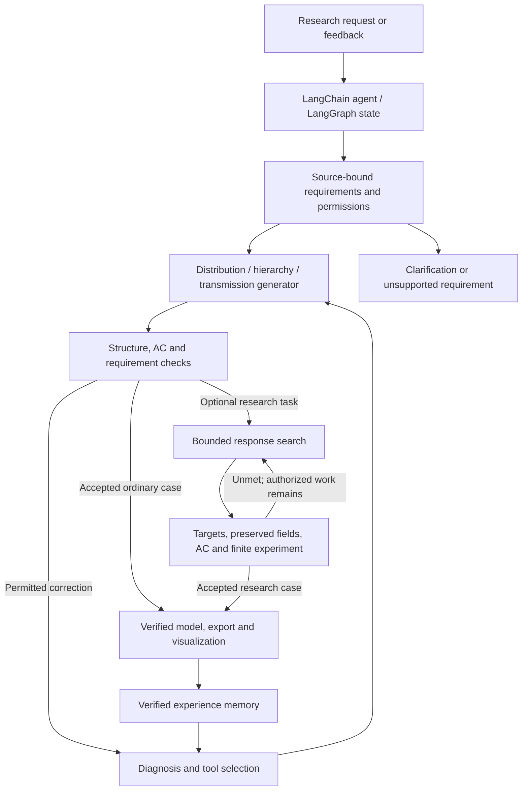

# Framework architecture

The language model interprets intent and organizes tools. Domain generators construct models, and numerical checks determine physical acceptance.

| Component | Main modules | Responsibility |
|---|---|---|
| Conversation/tool boundary | `agent`, `agent_prompt`, `agent_boundary`, `agent_results` | Bind actual user input, route tools, preserve scope and finish verified handoff |
| Planning/contracts | `adaptive_planning`, `requirement_contract`, `requirement_normalization`, `source_review` | Compile schema, source evidence, quantities, prohibitions and correction scope |
| Construction | `generation`, `hierarchy_workflow`, `transmission_model`, `transmission_topology` | Generate topology, equipment, injections and operating settings |
| Electrical execution | `simulation`, `dss_worker`, `transmission` | OpenDSS/PYPOWER evaluation and isolated native execution |
| Feedback | `planning_diagnostics`, `revisions`, domain feedback modules | Diagnose failures, make permitted changes and retain lineage |
| Response synthesis | `response_design`, `response_candidates`, `response_compensation`, `response_search` | Construct/rank candidates and validate original-reference constraints |
| Research tasks | `research_language`, `research_source`, `research_tasks` | Connect research purposes to response and finite-experiment contracts |
| Permissions | `response_permissions`, `response_permission_workflow` | Execute explicit amendments and preauthorized stages |
| Evidence/memory | Artifact readers, manifests, verified memory | Retrieve validated outputs and advisory repair experience |

These are specialized responsibilities, not a fixed requirement to invoke many independent LLM agents for every request. Simple requests can finish in one planning pass. Structured workflows can run without an LLM.

Ordinary delivery requires a saved usable model, supported export, electrical acceptance and satisfied requirements. Revision adds parent lineage and preservation checks. Response delivery adds interval attainment and independent perturbation verification; research-task delivery also requires its finite experiment.

Closed administrative clauses are compiled directly. Unknown or conflicting constraints remain visible. Compilation errors, contradictory input, unsupported requirements and unsuccessful bounded searches have different outcomes.

For unspecified transmission generator sites, graph-hop separation guides initial placement. Explicit sites remain authoritative. This does not grant relocation rights for saved models. The public OpenDSS simulation API executes through a persistent isolated worker with explicit failure and AC-call accounting.

[Method and equations](paper/METHOD.md) | [Evidence](results/README.md)
