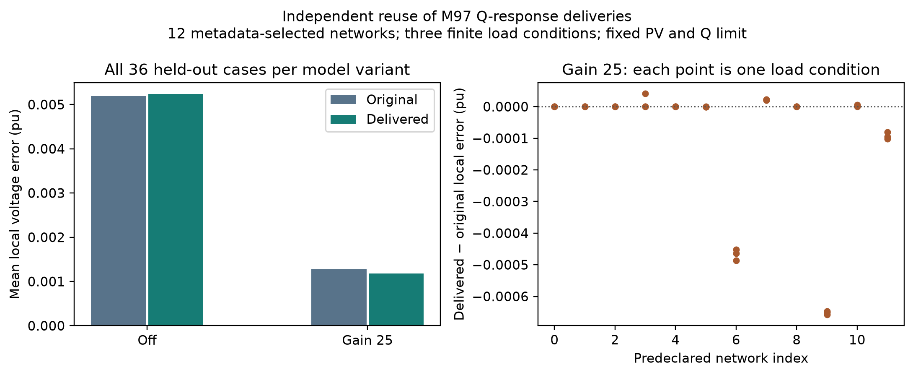

# Verified models and research evidence

The primary outcome is **final model correctness**: the saved case satisfies the request, passes its implemented electrical checks and can be loaded through the declared export. Recoverable intermediate errors do not invalidate a correct final delivery.

## 1. Requirement-controlled generation and revision

[Final deliveries](final_deliveries.csv) contains **30/30 accepted execution identities**, covering 15 positive requests with two repetitions each. The cases include urban/rural distribution, balanced/unbalanced representations, MV/LV hierarchy, transmission, protected revisions and the three supported research-task contracts. Each row links to an independent grade with measured properties, requirement checks and model identity.

The most recent focused check includes **8/8** accepted executions: two repetitions of a 71-bus hierarchical network, a 137-bus transmission network, a 223-bus transmission network, and a 63-bus unbalanced feeder with two protected revisions. All complete within the unchanged 180-second conversation limit. [Per-execution measurements](targeted_deliveries.csv).

The 223-bus model retains 20 generators, 640 MW demand, 220 kV, a 20 km radius, generator Q limits of +/-28.8 MVAr, 1.0 pu generator voltage settings and disabled automatic repairs. Its maximum absolute generator Q is 15.06955 MVAr and minimum Q-limit margin is 13.73045 MVAr. [Callable model](models/transmission_223/case_generated.m).

## 2. Response-conditioned generation

**118/118 certified feasible tasks** on 35 networks pass final target and protected-property checks. These comprise 225 response components: 96 Q-voltage, 96 P-voltage and 33 transmission-transfer components. Every component passes its full-step and half-step interval checks; the maximum ratio difference is 1.28954e-6.

The response cohort contains 118 tasks with successful baseline/feasibility certification from 120 originally planned tasks. Two tasks on one planned network failed baseline certification before search. The 118-task denominator is the certified design set, not all proposed inputs or arbitrary natural-language requests. Successful alternative numerical proposals also exist; these results demonstrate response-controlled generation and do not alone establish search-algorithm superiority.

- [Per-task deliveries](response_deliveries.csv)
- [All target components and numerical measurements](response_components.csv)
- [Vector target figure](response_targets.pdf)


## 3. Independent exported-model analysis

Twelve selected original/generated distribution pairs cover urban/rural cases, 23/37/59/79 buses, 6/10/20 kV and balanced/unbalanced representations. Recomputed central Q perturbations at full and half steps give **48/48** passing ratios, with maximum discrepancy 4.87067e-7 against saved measurements.

The same exported cases undergo 0.95, 1.05 and 1.10 load multipliers, with/without an external static Q controller. All **144/144** final AC evaluations converge, all 144 saved wrappers reload, and no final voltage/thermal violations occur under the tested settings. The maximum wrapper voltage discrepancy is 2.83e-11 pu.

Controller convergence is a separate research outcome: of 72 controlled runs, 60 reach the fixed-point stopping criterion and 12 reach the iteration cap; 36 saturate. These outcomes are retained in the table. They do not invalidate converged electrical model exports, and they are not evidence about dynamic stability.

- [Independent response ratios](independent_response_ratios.csv)
- [All 144 static runs](static_reuse_runs.csv)
- [Paired controller comparisons](paired_control.csv)
- [Control summary](control_summary.csv)
- [Vector control figure](static_control.pdf)



## 4. Reproduce and inspect

Run `python scripts/verify_release_results.py --solvers` to check table totals, grade links, integrity and the included callable models. Run `python scripts/build_gallery.py` to generate all seven public example models and figures using the current checkout. [Representative models](models/README.md) are compact executable examples; they are not the complete raw experiment archive.

An optional new configured-provider experiment can use the frozen request definitions:

```bash
python scripts/run_m101_language_evidence.py --root workspace/new_language_study \
  --freeze --cases docs/results/protocols/targeted_protocol.json
python scripts/run_m101_language_evidence.py --root workspace/new_language_study \
  --run --workers 4
```

Use a new destination. This calls the external provider configured in `.env` and creates fresh grades; it does not overwrite the published results. The original request text is preserved through Unicode escapes.

[Summary](summary.json), [provenance](provenance.json) and the result manifest retain evaluation identities, source versions and input hashes. The release contains final delivery evidence and compact numerical tables; private configuration, raw provider messages and large search intermediates are excluded. The reported counts describe these evaluated cases and do not imply universal 100% reliability.
